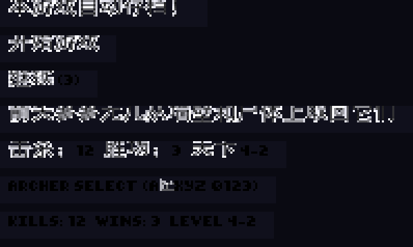
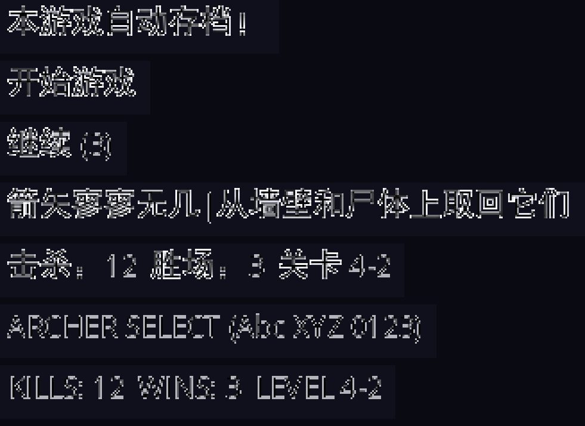
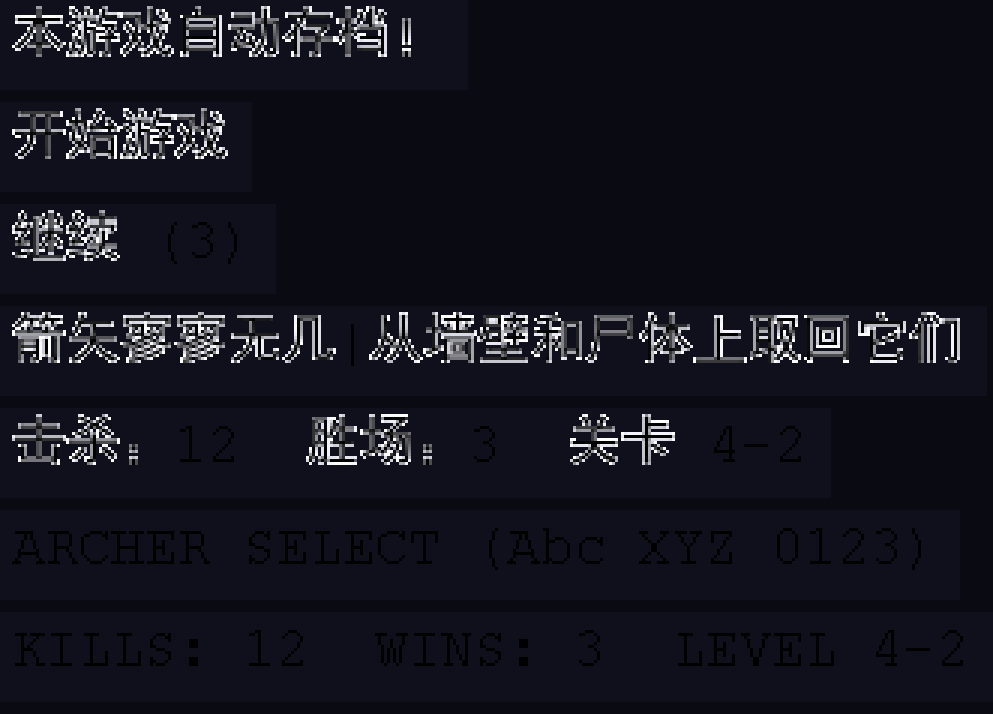

# TowerFall Ascension 简体中文汉化

适用于 **Steam 版 TowerFall Ascension（AppID 251470，Ver 1.3.3.3）** 的非官方简体中文汉化。

## 安装

1. 退出游戏；
2. 解压 [Releases](../../releases) 中的汉化包（或本仓库根目录的 `TowerFall-Ascension-汉化包-1.3.3.3.zip`）；
3. 把「汉化」文件夹里的全部文件按相同目录结构复制到游戏安装目录
   （Steam 中右键游戏 → 管理 → 浏览本地文件），覆盖提示选择覆盖；
4. 启动游戏即为中文界面。

覆盖的文件共 6 个：

```
TowerFall.exe
Content\Misc\Archer.xnb
Content\Misc\OpenSans.xnb
Content\Misc\MonocleDefault.xnb
Content\Atlas\GameData\questTips.xml
Content\Atlas\GameData\versusTips.xml
```

## 卸载

- 用汉化包里「卸载还原」文件夹中的原版文件覆盖回去；或
- Steam 中右键游戏 → 属性 → 已安装文件 → 验证游戏文件完整性。

## 汉化内容

| 项目 | 数量 | 说明 |
| --- | --- | --- |
| 程序界面文本 | 401 条 | 菜单、模式说明、设置项、存档提示等（原位替换 exe 内 .NET #US 字符串堆，不改任何 IL） |
| 小贴士 | 31 条 | questTips.xml（8 条）+ versusTips.xml（23 条） |
| 界面字体 | 3 套 | Archer / OpenSans / MonocleDefault 三套 SpriteFont 各加入 607 个中文字形（SimHei 11/18px），缺字回退显示「？」 |

图片、图集资源一律未改动。

## 渲染效果

三套字体的混排渲染预览（模拟 XNA SpriteBatch 绘制语义的程序化渲染）：

| Archer（主 UI 字体，11px） | OpenSans（18px） | MonocleDefault（18px） |
| --- | --- | --- |
|  |  |  |

## 制作工具链（tools/）

全部工具基于对官方 XNA 4.0 程序集（GAC 内 IL）逆向实证得到的 XNB 格式规范制作，关键结论：

- XNB v5 未压缩格式：7bit 编码的 reader 计数 / 字符串 / shared 资源计数等布局；
- SpriteFont 字符表以 UTF-8 变长编码存储（`BinaryReader.ReadChar`），因此 CJK 字符可直接存入；
- `GetIndexForCharacter` 为二分查找，字符表必须按码点升序，缺字时回退 `defaultCharacter`，否则抛 `ArgumentException`——这正是汉化前三个原版字体不含中文字形时游戏启动即崩溃的原因。

| 文件 | 用途 |
| --- | --- |
| `translations.py` | 翻译表：401 条 exe 字符串 + 31 条 XML 提示 |
| `patch_exe.py` | 原位替换 exe 的 .NET #US 字符串堆（新串 UTF-16 长度 ≤ 原槽位，IL 与元数据逐字节不变） |
| `patch_xml.py` | 汉化 questTips.xml / versusTips.xml（保留 BOM） |
| `parse_xnb3.py` | XNB v5 SpriteFont 独立解析器 |
| `make_font.py` | 字体生成器：解析原版字体 → 用 SimHei 渲染中文字形 → shelf 打包图集 → 按实证格式写出新 XNB；ASCII 字形像素级保留 |
| `validate_font.py` | 独立重解析校验 + 模拟 XNA 绘制预览 |
| `verify2.py` | 像素级校验：ASCII 与原版一致、CJK 字形有墨、全部翻译可渲染 |
| `fonttest/FontTest.cs` | 用真 XNA（GAC 官方程序集）实际加载生成的 XNB 并 MeasureString 验证 |

脚本内的游戏目录、备份目录等路径为硬编码（`D:\Steam\...`），复用时需自行修改。

## 声明

- 本汉化为非官方作品，仅供学习交流，请支持正版；
- 汉化包内含修改后的游戏二进制文件，版权归原作者所有；
- 仅适用于 Ver 1.3.3.3，游戏更新后请先验证文件完整性还原官方文件。
